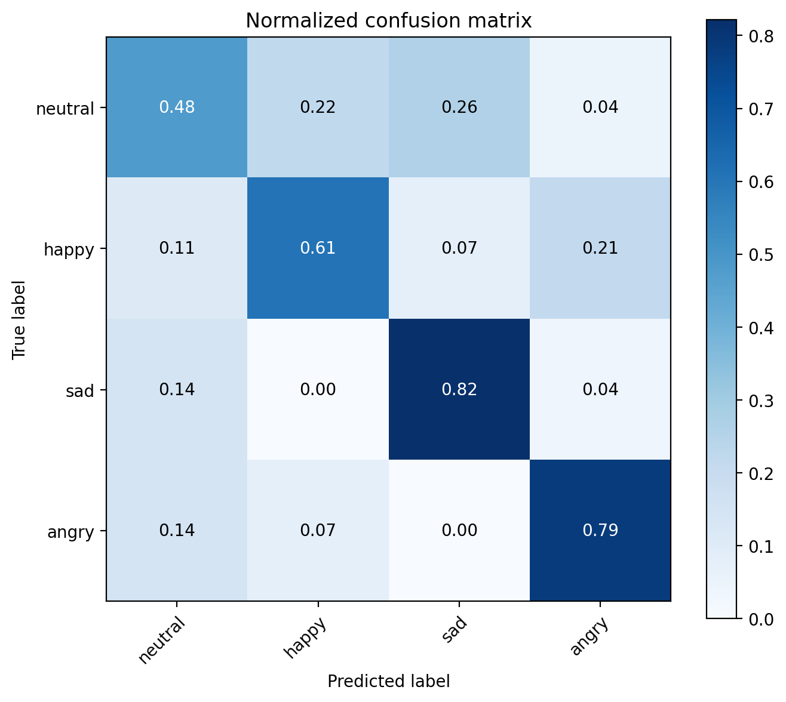
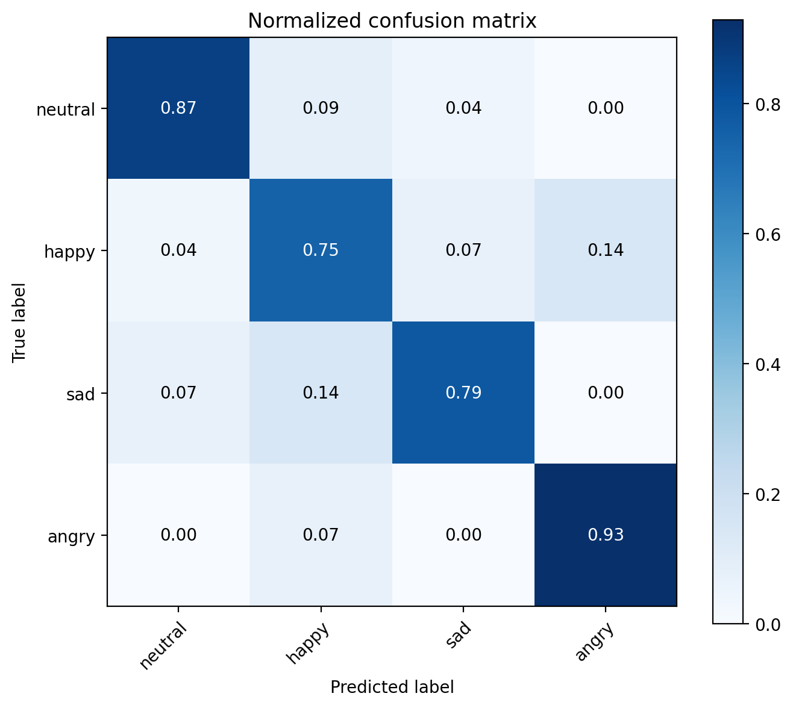
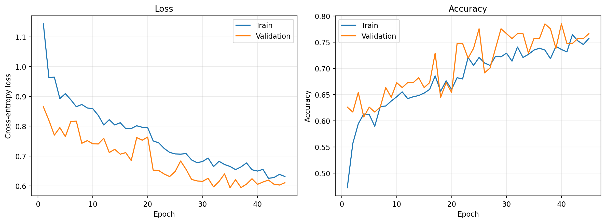
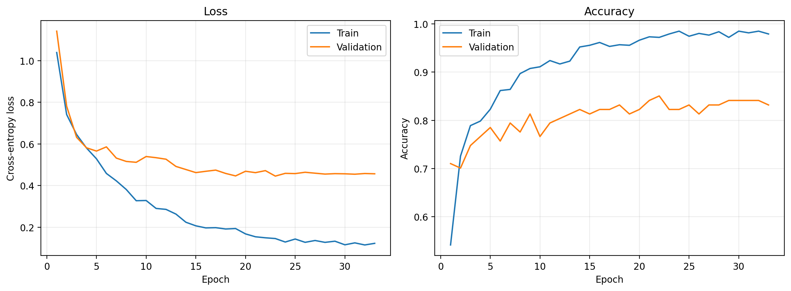

# Speech Emotion Recognition: Log-Mel CNN vs. Frozen HuBERT

**A comparative study of acoustic features and self-supervised speech representations for four-class emotion recognition.**

This project investigates whether representations from a frozen, pretrained speech model improve emotion classification over a convolutional network trained on log-Mel spectrograms. I compare two PyTorch pipelines on the **same 1,067-utterance subset of [CREMA-D](https://github.com/CheyneyComputerScience/CREMA-D)**, using matched stratified train/validation/test assignments and a reproducible training workflow.

**Main finding:** The frozen **HuBERT + MLP** pipeline achieves **83.18% test accuracy** and **83.33% macro-F1**, versus **68.22%** and **67.03%** for the log-Mel CNN—a **14.95 percentage-point** difference in accuracy on the held-out 107 clips.

> **Evaluation scope.** These are results for a four-emotion, 20-speaker *subset*, not the complete CREMA-D benchmark. The split is stratified **by emotion at the clip level**, not disjoint by speaker; therefore the reported scores must **not** be interpreted as unseen-speaker performance. The comparison evaluates two complete pipelines, not an isolated effect of feature selection.

## Research question and approach

Speech emotion recognition depends on acoustic cues such as pitch, intensity, spectral structure, and speaking style. The experiment contrasts two strategies for learning from those cues:

1. **Log-Mel CNN:** learn emotion-sensitive patterns from time–frequency features with a small, supervised convolutional model.
2. **Frozen HuBERT + MLP:** use contextual representations from a self-supervised speech encoder and train only a lightweight downstream classifier.

Both pipelines share the same selected audio clips, class definitions, split seed, audio duration, batch size, optimizer family, and evaluation metrics. They differ in representation, classifier architecture, and some regularization settings; the observed gap should be interpreted as a **pipeline-level comparison**.

## Experimental results

| Test metric | Log-Mel CNN | Frozen HuBERT + MLP |
|:--|--:|--:|
| **Accuracy** | **68.22%** | **83.18%** |
| **Macro precision** | 67.09% | 83.51% |
| **Macro recall** | 67.31% | 83.35% |
| **Macro F1** | **67.03%** | **83.33%** |
| Weighted F1 | 67.87% | 83.16% |
| Trainable classifier parameters | 618,692 | 198,404 |
| Selected checkpoint (epoch) | 35 | 23 |

*Results are from one recorded seed (42) and one shared test partition (107 clips). The frozen pretrained HuBERT encoder is **not included** in the 198,404 trainable-classifier-parameter count.*

### Class-wise F1

| Emotion | Test support | Log-Mel CNN | Frozen HuBERT + MLP |
|:--|--:|--:|--:|
| Neutral | 23 | 48.89% | 86.96% |
| Happy | 28 | 65.38% | 73.68% |
| Sad | 28 | 77.97% | 83.02% |
| Angry | 28 | 75.86% | 89.66% |

The largest class-level improvement is on **neutral** utterances. **Happy** remains the lowest-F1 class for the HuBERT pipeline, with some happy clips predicted as angry or sad. These observations describe this test split only; the experiment does not establish statistical significance or cross-speaker generalization.

### Normalized confusion matrices

Rows indicate the ground-truth emotion and columns indicate predictions; values are normalized within each ground-truth class.

| Log-Mel CNN | Frozen HuBERT + MLP |
|:--:|:--:|
|  |  |

### Training dynamics

| Log-Mel CNN | Frozen HuBERT + MLP |
|:--:|:--:|
|  |  |

The HuBERT classifier converges in fewer epochs, but exhibits a noticeable train–validation gap. Early stopping selects the checkpoint with the **lowest validation loss**, rather than the highest validation accuracy. The recorded runs terminate at epochs **45** (Mel-CNN) and **33** (HuBERT).

The underlying [per-run metrics](results/), [training histories](results/), and [portable split assignments](results/split_assignments.csv) are included for inspection. The four figures above are copies of the supplied experiment outputs, not recreated from hypothetical runs.

## Dataset and evaluation protocol

[**CREMA-D**](https://github.com/CheyneyComputerScience/CREMA-D) is an audiovisual emotion dataset containing 7,442 recordings from 91 actors across six emotion categories. This experiment uses the *processed audio WAVs* from actor IDs **1001–1020** and retains the four filename-derived labels below:

| Label index | Filename code | Emotion | Selected clips |
|--:|:--:|:--|--:|
| 0 | `NEU` | Neutral | 236 |
| 1 | `HAP` | Happy | 277 |
| 2 | `SAD` | Sad | 277 |
| 3 | `ANG` | Angry | 277 |
| | | **Total** | **1,067** |

The filename parser reads the actor ID from the first underscore-delimited field and the emotion code from the third (e.g. `1001_DFA_ANG_XX.wav`). Labels follow the supplied filename annotation, not a new aggregation of crowd ratings. Fear and disgust are excluded.

A two-stage, seeded (`42`) stratified split yields:

| Split | Neutral | Happy | Sad | Angry | Total |
|:--|--:|--:|--:|--:|--:|
| Train | 189 | 222 | 221 | 221 | **853** |
| Validation | 24 | 27 | 28 | 28 | **107** |
| Test | 23 | 28 | 28 | 28 | **107** |

The test set is evaluated after choosing a checkpoint by validation loss. **Speakers occur in more than one partition**: this design estimates performance on held-out utterances from a largely overlapping speaker population, rather than on new speakers.

### Shared audio processing

Each WAV file is decoded with TorchAudio, mixed down to mono, resampled to **16 kHz** as needed, and brought to a **3-second (48,000-sample)** window with center cropping or right-side zero padding. Features are computed once and cached on disk by their extraction settings and source-file identity.

## Models and mathematical formulation

### 1. Supervised log-Mel CNN

For waveform `x`, the short-time Fourier transform is projected onto a Mel filterbank to obtain Mel power features. Conceptually, the log-Mel representation is

```math
P_{m,t} = \sum_{k=0}^{K-1} H_{m,k}\,\lvert X_{k,t}\rvert^2,
\qquad
S_{m,t} = 10\log_{10}\left(\max(P_{m,t},\varepsilon)\right),
```

where `X` is the windowed Fourier transform and `H` is the Mel filterbank. In code this is `torchaudio.transforms.MelSpectrogram` followed by `AmplitudeToDB`, with an **80 dB dynamic-range cap** and **no additional per-spectrogram standardization**.

| Component | Recorded setting |
|:--|:--|
| Input | 80 Mel bins, 16 kHz audio |
| STFT/Mel | FFT 512; Hann window 400 samples; hop 160 samples (10 ms) |
| CNN backbone | Three `Conv2d → BatchNorm → ReLU → MaxPool2d → Dropout2d` blocks |
| Channels | 32 → 64 → 128, with 3×3 convolutions |
| Pooling | 2×2 max pooling in each block; adaptive average pooling to 4×4 |
| Classifier | Flatten → Linear(2048, 256) → ReLU → Dropout(0.10) → Linear(256, 4) |
| Regularization | 0.05 spatial dropout within each CNN block |

The Mel-CNN parameters are learned end-to-end from the selected labeled subset; no pretrained weights are used.

### 2. Frozen HuBERT representations with an MLP

The second pipeline uses the pretrained [TorchAudio `HUBERT_BASE`](https://docs.pytorch.org/audio/stable/pipelines.html) speech encoder, based on [HuBERT](https://arxiv.org/abs/2106.07447). Its **pretraining is self-supervised**, but this project does **not** pretrain or fine-tune the encoder. The encoder runs in evaluation/inference mode with gradients disabled.

`Wav2Vec2FeatureExtractor` normalizes the waveform before it is passed to HuBERT. The implementation uses the **final transformer-layer hidden sequence**, then applies length-masked temporal mean pooling:

```math
(h_1,\ldots,h_T) = f_{\theta}(\widetilde{x}),
\qquad
z = \frac{\sum_{t=1}^{T} a_t h_t}{\sum_{t=1}^{T} a_t},
\qquad
z\in\mathbb{R}^{768},
```

where `a_t` is a binary validity indicator obtained from the returned sequence lengths. A **768 → 256 → 4** classifier applies batch normalization, ReLU, and **0.40 dropout** after its hidden linear layer. The code also supports max or first-token pooling through configuration; **mean pooling is the recorded experiment**.

**Implementation caveat:** Audio is padded to a fixed duration *before* the processor creates its attention mask. Consequently, that mask does not necessarily distinguish original audio from added zero padding; padding can affect the pooled representation. Mask-aware preprocessing is a useful follow-up experiment.

### Objective and model selection

Both classifiers use multiclass cross-entropy loss on four output logits:

```math
\mathcal{L}_{\mathrm{CE}} = -\frac{1}{B}\sum_{i=1}^{B}
\log\left(\frac{e^{s_{i,y_i}}}{\sum_{c=1}^{4} e^{s_{i,c}}}\right).
```

The optimizer is **Adam** (learning rate `3e-4`, weight decay `5e-4`), with batch size **32**, gradient norm clipping at **5.0**, and `ReduceLROnPlateau` (`factor=0.5`, `patience=2`). Training runs for at most **100 epochs** with early stopping after **10 epochs** without sufficient validation-loss improvement. The best checkpoint is selected by **minimum validation loss** (improvement threshold `1e-4`).

Evaluation reports accuracy, class-wise precision/recall/F1, macro-averaged scores, weighted F1, and confusion matrices. For completeness, macro-F1 is

```math
F_{1,\mathrm{macro}} = \frac{1}{4}\sum_{c=1}^{4}
\frac{2P_cR_c}{P_c+R_c}.
```

## Reproducing the experiments

### 1. Set up Python

Use **Python 3.10+** and a compatible installation of PyTorch and TorchAudio (choose CPU or CUDA wheels using the [PyTorch install instructions](https://pytorch.org/get-started/locally/)). From the repository root:

```bash
python -m venv .venv
# Linux/macOS:
source .venv/bin/activate
# On Windows, activate .venv\Scripts\activate instead.
python -m pip install -r requirements.txt
```

The requirements list dependencies but **does not claim to be an exact historical environment lockfile**, since package versions used in the recorded runs were not provided. Recent TorchAudio builds may require [TorchCodec and FFmpeg](https://docs.pytorch.org/audio/stable/installation.html) for `torchaudio.load`.

### 2. Download CREMA-D audio

Obtain the processed WAVs through the [CREMA-D project](https://github.com/CheyneyComputerScience/CREMA-D) (or its [official mirror](https://gitlab.com/cs-cooper-lab/crema-d-mirror)) and place the `.wav` files here:

```text
data/dataset/AudioWAV/
├── 1001_DFA_ANG_XX.wav
├── 1001_DFA_HAP_XX.wav
└── ...
```

Raw audio is **not included** in this repository. The configured speaker IDs and emotion codes will select the experimental subset automatically.

### 3. Train and evaluate both pipelines

The commands below use dedicated, portable configs reconstructed to match the archived experiments' recorded model and training settings:

```bash
# Log-Mel CNN
python -m scripts.main --config config/config_mel.yaml --mode all

# Frozen HuBERT features + MLP (downloads pretrained weights on first use)
python -m scripts.main --config config/config_hubert.yaml --mode all
```

Each run produces the test classification report, metrics, confusion matrices, training curves, logged configuration, and split manifest in its own `outputs/mel/` or `outputs/hubert/` directory. Model weights are saved separately under `models/saved_models/mel/` and `models/saved_models/hubert/`.

To evaluate existing checkpoints:

```bash
python -m scripts.main --config config/config_mel.yaml --mode evaluate \
  --checkpoint models/saved_models/mel/best.pt

python -m scripts.main --config config/config_hubert.yaml --mode evaluate \
  --checkpoint models/saved_models/hubert/best.pt
```

Run `--mode train` to train without executing the test stage. The original `config/config.yaml` is retained as a general-purpose example; use the **named configs above** when trying to reproduce the reported runs.

The loader seeds Python, NumPy, and PyTorch; employs deterministic-algorithm settings where supported; and stores a manifest of assigned clips. Results can still vary across package versions, operating systems, numerical kernels, and devices. Full byte-for-byte reproduction is **not** guaranteed without the original software environment and dataset files.

## Repository structure

```text
.
├── config/
│   ├── config.yaml                 # General configurable example
│   ├── config_mel.yaml             # Settings for reported Mel-CNN experiment
│   ├── config_hubert.yaml          # Settings for reported HuBERT experiment
│   └── logging.yaml
├── data/
│   ├── data_loader.py             # Data discovery, preprocessing, splitting, caching
│   └── dataset/                   # External CREMA-D WAVs (ignored by Git)
├── models/
│   └── model.py                   # MelCNN and HuBERTMLP
├── scripts/
│   ├── main.py                    # CLI orchestration
│   ├── train.py                   # Optimization and checkpoint selection
│   └── evaluate.py                # Held-out evaluation and reporting
├── utils/                         # Feature extractors, metrics, plots, seeds, config
├── figures/                       # Tracked diagnostic plots from the recorded runs
├── results/                       # Tracked metrics, histories and split assignments
├── requirements.txt
└── README.md
```

## Limitations and next steps

- **Speaker overlap:** Use actor-disjoint train/validation/test partitions (e.g., grouped splits or speaker-wise cross-validation) to evaluate generalization to unseen voices.
- **Limited scale:** This study covers four emotions and 20 of the dataset's 91 actors; expand to all six emotions and more actors for broader coverage.
- **Single run:** Repeat each condition across multiple seeds and report dispersion or confidence intervals rather than treating a single held-out score as conclusive.
- **Not a feature-only ablation:** Architectures and regularization settings differ across the two pipelines. Match downstream model capacity and tune under an explicit validation budget before attributing the gap solely to representation quality.
- **Pooling and domain shift:** Compare masked/attention pooling, alternative HuBERT layers, trainable fine-tuning, and cross-dataset evaluation; inspect sensitivity to zero padding and spoken content.

This repository is an **experimental comparison and reproducible implementation**, not a claim of state-of-the-art performance or a new speech representation model.

## References and acknowledgments

1. **CREMA-D:** Cao, H., Cooper, D. G., Keutmann, M. K., Gur, R. C., Nenkova, A., & Verma, R. (2014). *CREMA-D: Crowd-sourced Emotional Multimodal Actors Dataset.* IEEE Transactions on Affective Computing, 5(4), 377–390. [DOI: 10.1109/TAFFC.2014.2336244](https://doi.org/10.1109/TAFFC.2014.2336244).
2. **HuBERT:** Hsu, W.-N., Bolte, B., Tsai, Y.-H. H., Lakhotia, K., Salakhutdinov, R., & Mohamed, A. (2021). *HuBERT: Self-Supervised Speech Representation Learning by Masked Prediction of Hidden Units.* [arXiv:2106.07447](https://arxiv.org/abs/2106.07447).
3. **Software:** [PyTorch](https://pytorch.org/), [TorchAudio](https://docs.pytorch.org/audio/stable/), [Hugging Face Transformers](https://huggingface.co/docs/transformers/), and [scikit-learn](https://scikit-learn.org/).

The CREMA-D dataset is distributed under the licensing terms stated by its [maintainers](https://github.com/CheyneyComputerScience/CREMA-D). The repository does not redistribute dataset audio or pretrained HuBERT weights.
